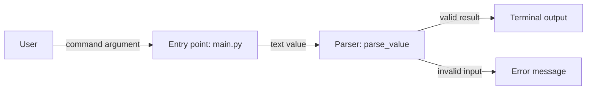

# Architecture that evolves with the build

## Keep views distinct

Maintain `.project-learning/ARCHITECTURE.md` as the current index. Include:

- **Target:** proposed destination and deferred components.
- **Reference:** verified structure of the original repository, when one exists.
- **Built now:** only components actually created in the learning workspace; distinguish created from executed/verified.
- Current request/data/control flow and links to relevant diagrams.
- Component-to-file/symbol mapping and important boundaries.
- Changes by lesson: what was added/removed, why, and what remains deferred.

Label diagrams with lesson ID and scope. Use `diagrams/L04-component.mmd`, `diagrams/L04-sequence.mmd`, or similarly stable names. Keep earlier milestone diagrams when they help explain architecture evolution; update the index to the current ones. Do not emit every diagram type for every lesson.

## Choose the diagram by the question

| Learning question | Suitable diagram |
| --- | --- |
| Who uses the system and what is outside it? | Context/component flowchart. |
| Which files own which responsibilities? | Component/module diagram with file mapping. |
| What happens in a single request or event? | Sequence diagram. |
| How does a function choose a branch? | Control-flow chart. |
| How does information transform or persist? | Data-flow diagram or ER diagram. |
| How do states change over time? | State diagram. |
| What processes or machines run this? | Deployment diagram, only when relevant. |

Use a small overview plus a focused detailed view for complex systems. Label arrows with the data, command, or call, and explain their direction. Include a relevant error path when taught. Do not add caches, queues, gateways, replicas, or cloud services just to make the diagram look advanced.

## Example: a built component view

This is an illustrative local CLI, not a prescribed architecture:



ASCII fallback:

```text
User --argument--> main.py --> parse_value
                                | valid --> terminal output
                                | invalid --> error message
```

Each important node should have a nearby mapping to its actual file/symbol. If it is merely planned, move it to the target view or explicitly mark it as proposed. Describe the flow in plain language for readers unfamiliar with diagram notation.

## Update procedure

After each relevant increment:

1. Compare current files and behavior with the last diagram.
2. Add or revise components, arrows, branch conditions, or data fields that changed.
3. Record why the boundary changed and the simpler alternative considered, if any.
4. Trace one real input against both code and diagram; repair disagreements.
5. Save the new milestone and update the architecture index and lesson links.

Validate Mermaid syntax with available tooling when practical. If only source inspection was possible, say rendering was not checked. A syntactically valid diagram can still be semantically wrong; file mappings and traces are the main correctness checks.

## Glossary and code vocabulary

Maintain `.project-learning/GLOSSARY.md` with a table:

| Term/symbol | Plain meaning | Category | Project/code example | First lesson | Related terms |
| --- | --- | --- | --- | --- | --- |

Categories include domain terms, language keywords/operators, framework APIs, configuration, terminal commands, architecture, protocols, and acronyms. Include important short identifiers such as `req`, `ctx`, or `id` when their meaning is unclear. Distinguish language keywords from library functions and project-defined names.

Expand acronyms on first use. Link a term to the actual file/block or lesson where it appears; for concepts without code, link the diagram or example. Add relevant terms as encountered rather than dumping an encyclopedic glossary. Update corrected definitions and record misconceptions in the question log rather than preserving incorrect definitions.
